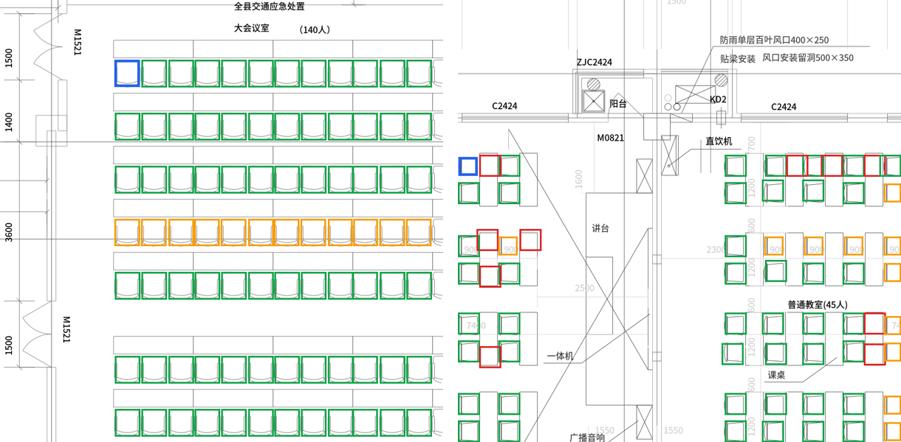

# PlanSpot

**One-shot symbol spotting and thin-structure segmentation on CAD drawings, with DINOv2.**

Box one symbol on a floor plan (a door, a fixture, a seat) and PlanSpot finds every other instance, in any of 8 orientations, without training for that symbol. Phase 2 fine-tunes DINOv2 with LoRA to segment walls, which are 1–3 px strokes.

- **Results viewer (static, no install):** https://huggingface.co/spaces/dzakybd/planspot
- **Live demo (local):** `uv sync && uv run python app.py`



*Left: pixel NCC finds every seat except one row, where a dimension line crosses the symbols. Right: DINOv2 finds chairs in both orientations, with a few false positives at desk corners. Blue = exemplar, green = correct, red = false positive, orange = missed.*

## Why this problem

Construction estimators count symbols and measure runs on drawing sets of 300+ sheets. Each project's legend defines its own symbols, so a detector trained on fixed classes misses the long tail. One-shot spotting ("find more of this") is the label-free way to handle a new legend. Drawings are also unlike photos: a 36"×24" sheet at 300 DPI is 10,800 × 7,200 px, symbols are 20–60 px, and lines are 1–3 px wide.

## Method (phase 1)

| Step | What |
|---|---|
| Features | Frozen **DINOv2-S/14**, input upsampled **2×** and run in **overlapping 518 px tiles**, so a 40 px symbol spans ~6 patches instead of ~3 |
| Exemplar | The template is the exemplar's **in-context** patch features from the drawing's own feature map (embedding the crop alone on a blank canvas lost context: self-match ≈ 0.7 instead of 1.0) |
| Orientation | The whole drawing is embedded in the **8 dihedral poses** (4 rotations × mirror); matches are mapped back to the original frame |
| Matching | Mean cosine similarity between template cells and every window → local maxima → NMS |
| Baseline | **Pixel NCC** template matching (OpenCV) over the same 8 poses |
| Cut-off | A global threshold tuned on validation, or an **adaptive** per-query cut at the largest gap in the sorted scores |

## Benchmark

**Data:** FloorPlanCAD (Fan et al., ICCV 2021): real CAD floor-plan tiles of 1000 × 1000 px with instance boxes, from the [Voxel51 export](https://huggingface.co/datasets/Voxel51/FloorPlanCAD) (CC BY-NC 4.0).

**Protocol:**
- An episode is one tile plus one symbol class with ≥ 2 instances. The first instance (top-left) is the exemplar, and the task is to find the rest.
- A prediction is correct at IoU ≥ 0.5 with an unmatched ground-truth box.
- **Splits are by source drawing**, never by tile: 20% of drawings for tuning thresholds (val), the rest for reporting (test).
- 150 tiles per split, and **both methods are scored on the same tiles**.

| Method | Cut-off | Precision | Recall | **F1** | F1 small (<48 px) | F1 medium | F1 large | Count error (MAPE) |
|---|---|---|---|---|---|---|---|---|
| Pixel NCC | global 0.90 | 0.502 | 0.434 | 0.466 | **0.767** | 0.344 | 0.402 | 1.59 |
| DINOv2-S, 2×, tiled | global 0.82 | 0.776 | 0.357 | 0.489 | 0.664 | **0.448** | 0.400 | **0.66** |
| DINOv2-S, 2×, tiled | adaptive gap, floor 0.70 | 0.717 | 0.401 | 0.514 | | | | |
| Pixel NCC | adaptive gap, floor 0.82 | **0.805** | 0.423 | **0.555** | | | | |

Test split: 369 episodes, 1,142 instances. Reproduce with `python -m planspot.evaluate --method {ncc,dino} --images 150`, then `python -m planspot.adaptive`.

### What I learned

1. **The classical baseline is strong on CAD.** Symbols in CAD are exact block copies, so pixel NCC wins on small symbols (0.77 vs 0.66). Report the simple baseline before claiming a foundation-model gain.
2. **DINOv2 buys precision and robustness, not raw recall.** Precision is 0.78 vs 0.50, count error is less than half, and it wins on medium symbols, where overlapping linework and partial views break pixel matching (see the crossed row in the figure).
3. **The cut-off matters as much as the backbone.** The best threshold varies per drawing, so a per-query rule (largest score gap) adds +9 F1 points to NCC and +2.5 to DINO. It fails on ties: when identical symbols score 0.99–1.00, it can cut between them (drawing 1 in the viewer).
4. **Recall (~0.4) is now the bottleneck for every method.** Next suspects: symbols clipped at tile borders, variant drawings of the same class, and the strict IoU ≥ 0.5 on tiny boxes.

### Next experiments

- **Hybrid:** DINO proposals verified by NCC, or score fusion, to combine DINO's precision with NCC's exactness on small symbols.
- **Tie-aware adaptive cut**, e.g. a minimum gap relative to the score spread.
- **Recall analysis** by failure type (clipped, variant, occluded).
- A **learned matcher** (a small head trained on DINO features across classes) instead of raw cosine similarity.

## Phase 2: wall segmentation with DINOv2 + LoRA

Walls in FloorPlanCAD are thin stroke outlines (about 2% of pixels). The model fuses **DINOv2 features** (context: "is this stroke a wall?") with a **light full-resolution pixel branch** (geometry: "exactly where?"), and decodes with skips to full resolution.

The ablation, on held-out drawings:

| Variant | What changes |
|---|---|
| `unet` | Pixel branch + decoder only |
| `frozen` | + frozen DINOv2-S features |
| `lora` | + LoRA (r = 8) on DINOv2 attention `q_proj` / `v_proj` |
| `lora_cldice` | + soft-clDice loss for connectivity (Shit et al., CVPR 2021) |

Metrics: F1 with 2 px tolerance, clDice, and the mean absolute error in the number of connected wall pieces per tile (lower = fewer broken or merged walls). Same budget for every variant: 1,500 steps, batch 8, 1,500 training tiles, 200 held-out tiles, one seed, M1 Pro.

| Variant | Trainable params | F1 (2 px) | Precision | Recall | clDice | Component count error | Train time |
|---|---|---|---|---|---|---|---|
| `unet` | 192K | 0.704 | 0.643 | **0.858** | 0.631 | 47.0 | 15 min |
| `frozen` | 254K | 0.731 | 0.735 | 0.798 | 0.664 | 31.0 | 13 min |
| `lora` | 401K | **0.761** | **0.737** | 0.838 | **0.690** | 29.1 | 25 min |
| `lora_cldice` | 401K | 0.748 | 0.722 | 0.831 | 0.684 | **22.3** | 25 min |

What it shows:

- **DINOv2 context helps thin structures.** Frozen features alone lift precision from 0.64 to 0.74: the pixel-only U-Net marks every stroke as wall, including furniture and dimension lines.
- **LoRA beats frozen** by 3 F1 points and 2.6 clDice points for ~150K extra parameters. Adapting the attention to line drawings matters, not just the head.
- **clDice trades a little F1 for topology.** It cuts the component count error by 23% (29.1 → 22.3), so fewer walls come out broken, while pixel F1 drops 1.3 points. For takeoff, where a broken wall becomes a wrong length, that is the trade to want.
- **Caveat:** one seed and 200 tiles. Differences of 1–3 points are a trend, not a settled result.

```bash
python -m planspot.train_walls --data <floorplancad> --variant lora --steps 1500 --batch 8
```

## Layout

```
src/planspot/spotter.py      NCC and DINOv2 spotters, tiling, pose handling
src/planspot/evaluate.py     one-shot benchmark (drawing-level splits)
src/planspot/adaptive.py     global vs per-query cut-offs, from saved episode scores
src/planspot/walls.py        phase 2 data, fusion model, clDice, metrics
src/planspot/train_walls.py  phase 2 training + evaluation
src/planspot/export_viewer.py  precomputes the static viewer data
app.py                       Gradio demo (local)
space/                       static Hugging Face Space (viewer)
results/                     benchmark JSON
```

## Data and setup

```bash
uv sync
# FloorPlanCAD (Voxel51 export): samples.json + data/*.png
python -c "from huggingface_hub import snapshot_download; snapshot_download('Voxel51/FloorPlanCAD', repo_type='dataset', local_dir='floorplancad')"
python -m planspot.evaluate --data floorplancad --method dino --images 150
```

Runs on Apple Silicon (MPS), CUDA, or CPU. The numbers above came from an M1 Pro.

**Note on labels:** some class names in the Voxel51 export look shifted (for example, double swing doors labeled `sliding_door`). The benchmark only needs consistent grouping, so names are reported as stored, and the README only names classes I checked by eye.

## License

Code: MIT. Data: FloorPlanCAD is CC BY-NC 4.0 (non-commercial). Example images in `space/` and `examples/` come from it. DINOv2: Apache 2.0.
